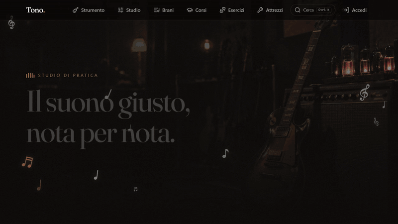
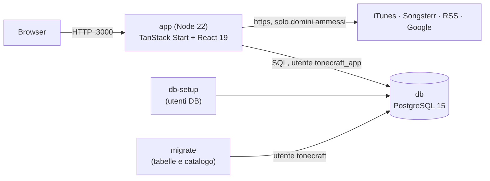
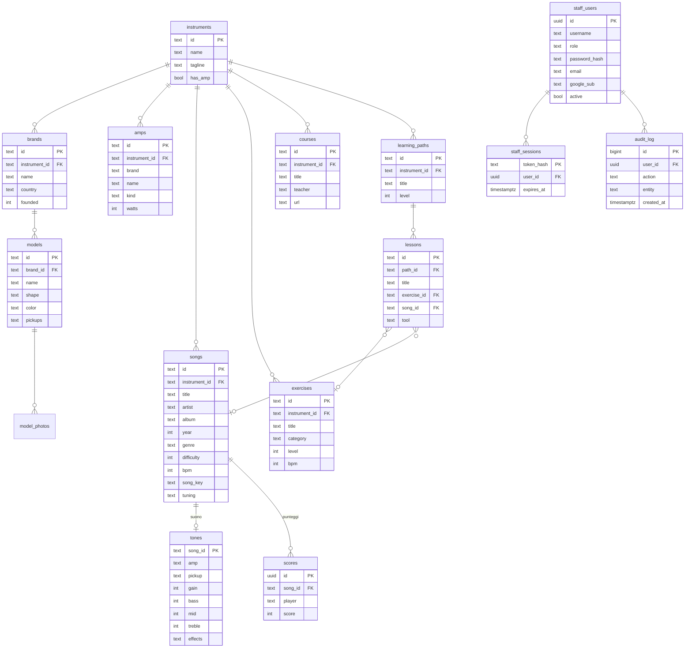
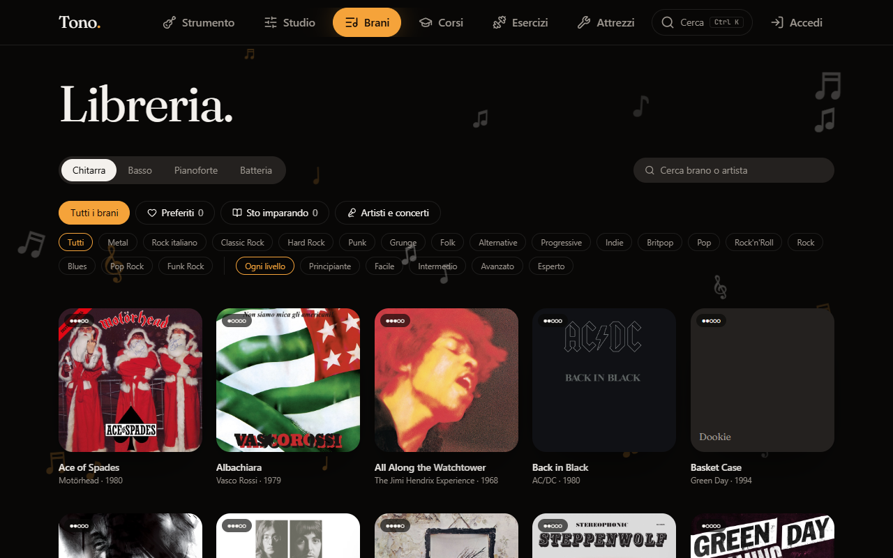
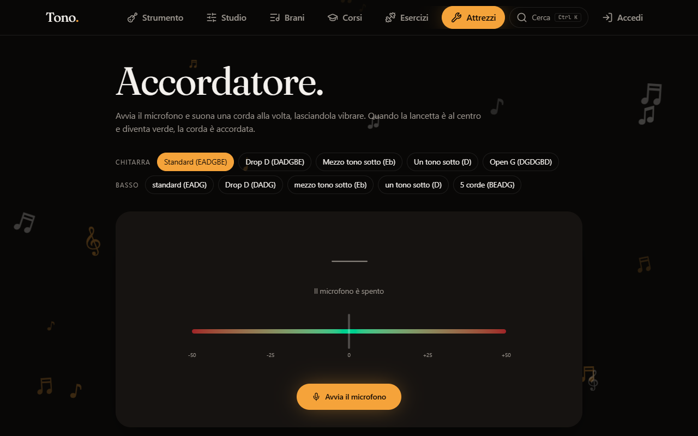
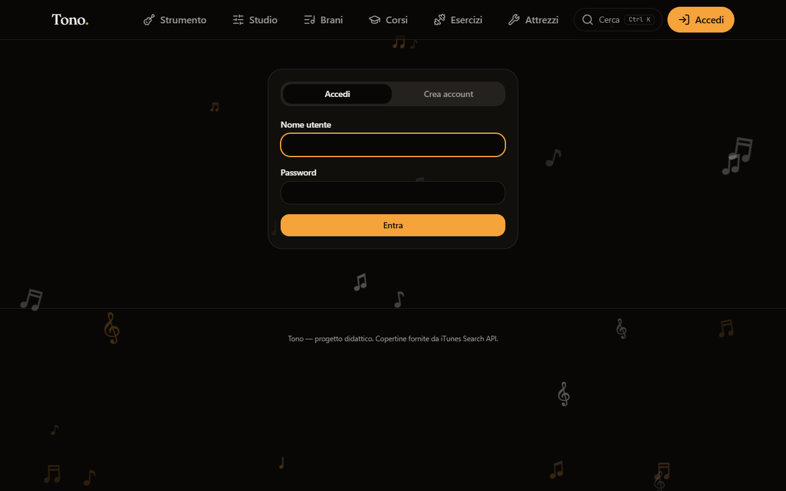
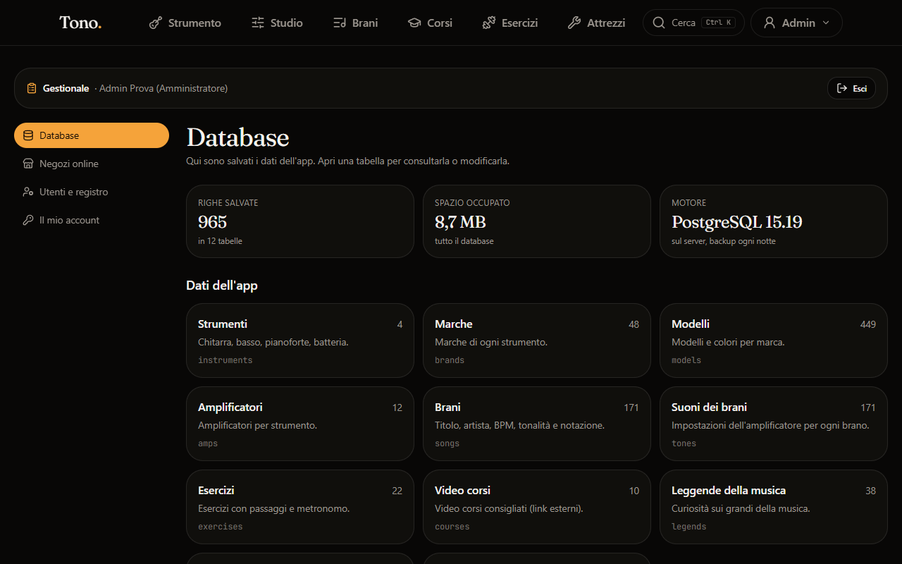
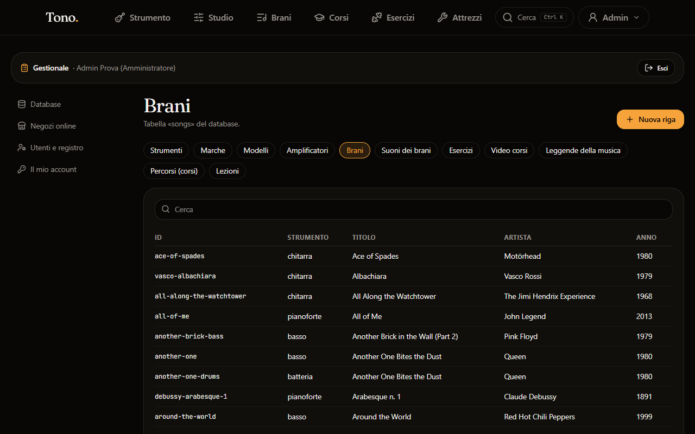
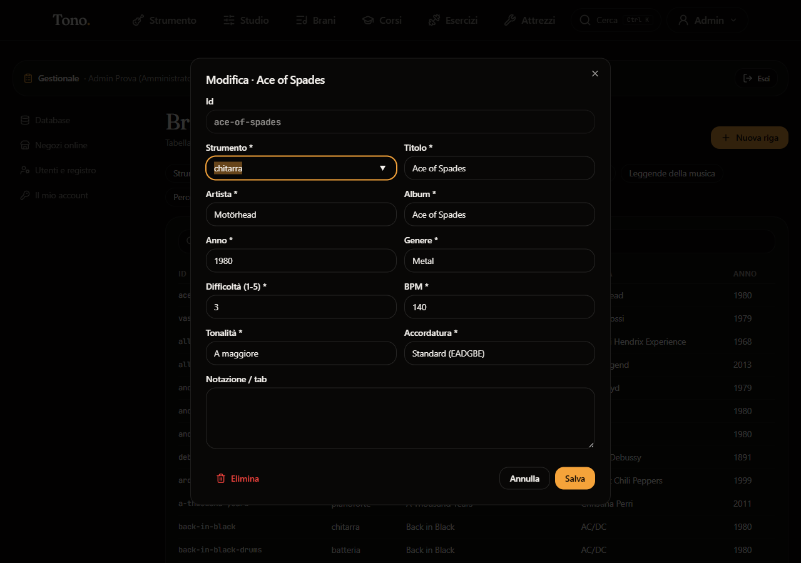
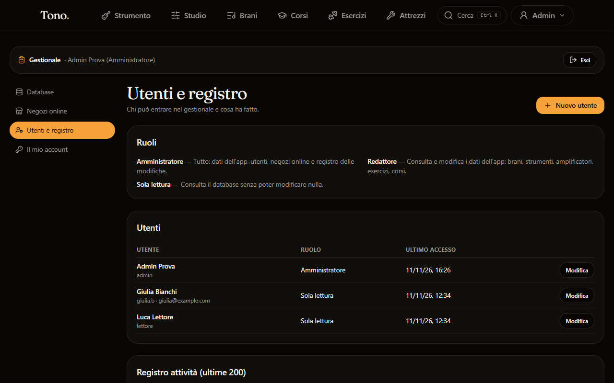

# Tono — studio di pratica musicale con gestionale

**Tono** è una web app per chi suona chitarra, basso, pianoforte o batteria. Si sceglie lo strumento, la marca, il
modello e l'amplificatore. Poi si imparano i brani di una libreria di **171 canzoni**, con le impostazioni di
amplificatore ed effetti per avvicinarsi al suono del disco, la copertina dell'album e l'anteprima audio.
Ci sono anche esercizi, corsi a lezioni, un accordatore, un metronomo, una base su cui suonare e giochi sulla tastiera.

Contiene anche un **gestionale**: un'area riservata con login e ruoli. Da lì si consultano e modificano tutti i dati
dell'app salvati nel database PostgreSQL (strumenti, marche, modelli, amplificatori, brani, suoni, esercizi, corsi…).

Tutto parte con **Docker Compose**: database, utenti del database, migrazioni e app.



## Indice

- [Funzionalità](#funzionalità)
- [Avvio rapido con Docker](#avvio-rapido-con-docker)
- [Primo accesso e dati di prova](#primo-accesso-e-dati-di-prova)
- [Sviluppo senza Docker](#sviluppo-senza-docker)
- [Architettura e tecnologie](#architettura-e-tecnologie)
- [Schema del database](#schema-del-database)
- [Servizi esterni (API di terze parti)](#servizi-esterni-api-di-terze-parti)
- [Sicurezza](#sicurezza)
- [Test](#test)
- [Installazione su Raspberry Pi](#installazione-su-raspberry-pi)
- [Screenshot](#screenshot)
- [Sviluppi futuri](#sviluppi-futuri)
- [Riferimenti](#riferimenti)

## Funzionalità

**App (pubblica, senza account)**
- Scelta dello strumento, della marca e del modello (centinaia di modelli reali, con filtri e ricerca)
  e dell'amplificatore (con disegno vettoriale). La scelta resta salvata nel browser.
- Libreria brani filtrabile per strumento, genere e difficoltà. Ogni brano ha copertina, anteprima audio di 30 secondi,
  tonalità, accordatura, BPM, impostazioni del suono, link alla tablatura e gioco «suona insieme».
- Esercizi, corsi a lezioni, accordatore (microfono), metronomo, accordi, base ritmica, allenamento dell'orecchio,
  gioco sulla tastiera, sessione guidata e statistiche di pratica (salvate nel browser).
- Notizie musicali (feed RSS) e link per cercare i concerti degli artisti preferiti.
- App installabile (PWA), con funzionamento offline delle pagine già visitate.

**Gestionale (`/gestionale`, con login)**
- **Login / logout** con nome utente e password, oppure con **Google** (se configurato). Chiunque può **creare un
  account**, che parte in sola lettura.
- Tre ruoli: **Amministratore** (tutto), **Redattore** (modifica i dati dell'app), **Sola lettura**.
- **Data entry ed editing**: per ogni tabella del catalogo si possono cercare, aggiungere, modificare ed eliminare
  righe, con moduli validati (campi obbligatori, numeri, chiavi esterne con menu a tendina). Le modifiche si vedono
  subito nell'app.
- Panoramica del database (righe e spazio per tabella), negozi online di fiducia, gestione utenti e **registro di tutte
  le modifiche** (chi, cosa, quando).

## Avvio rapido con Docker

**Serve solo** [Docker](https://docs.docker.com/get-docker/) con Docker Compose **2.24 o più recente**
(Docker Desktop su Windows/macOS, Docker Engine su Linux) e [Git](https://git-scm.com/).
Node.js non serve: l'app viene compilata dentro Docker.

```bash
git clone https://github.com/Filippo-Cappellini/tonecraft-song-studio.git
cd tonecraft-song-studio
cp .env.db.example .env.db        # Windows PowerShell: copy .env.db.example .env.db
docker compose up -d --build
```

Apri **http://localhost:3000**. La prima build richiede qualche minuto.

`.env.db` contiene le password del database (`POSTGRES_PASSWORD`, `APP_DB_PASSWORD`, `APP_RUNTIME_PASSWORD`, solo
lettere e cifre) e le porte. Per provare sul proprio PC vanno bene quelle di esempio; per qualunque altro uso
**cambiale**. Il file non va su git.

Cosa parte, in ordine (`docker compose ps -a`):

| Servizio | Container | Cosa fa |
|---|---|---|
| `db` | `tonecraft-db` | PostgreSQL 15. I dati restano nel volume `tonecraft-db`. Porta solo su `127.0.0.1` (`DB_PORT`, 55432 nell'esempio) |
| `db-setup` | `tonecraft-db-setup` | crea l'utente limitato del database `tonecraft_app`, poi si ferma |
| `migrate` | `tonecraft-migrate` | crea le tabelle e carica tutto il catalogo (`drizzle/migrations`), poi si ferma |
| `app` | `tonecraft-app` | l'app e il gestionale su `http://localhost:3000` (`APP_PORT`) |

`db-setup` e `migrate` restano «Exited (0)»: è normale.

Comandi utili:
```bash
docker compose logs -f app       # log dell'app
docker compose down              # ferma tutto (i dati restano)
docker compose down -v           # ferma e CANCELLA il database (al prossimo avvio si ricrea da zero)
docker compose up -d --build     # dopo un git pull: ricostruisce l'app e applica le nuove migrazioni
docker exec -it tonecraft-db psql -U postgres -d tonecraft   # console SQL
```

Se la porta 3000 o 55432 è già occupata, cambia `APP_PORT` o `DB_PORT` in `.env.db`.

## Primo accesso e dati di prova

Il **catalogo è già pieno** dopo il primo avvio, perché lo caricano le migrazioni: 4 strumenti, 48 marche, 449 modelli,
12 amplificatori, 171 brani con relativi suoni, 22 esercizi, 5 percorsi con 32 lezioni e 10 video corsi.

Gli **utenti** invece non ci sono. Crea l'amministratore (la password viene chiesta e non si vede mentre la scrivi):
```bash
docker exec -it tonecraft-app node scripts/crea-utente.mjs --username admin --nome "Mario Rossi" --ruolo admin
```
Regole per la password: almeno 12 caratteri con almeno 3 tipi tra minuscole, maiuscole, cifre e simboli (oppure una
frase di 20+ caratteri), senza il nome utente e senza sequenze comuni.

Poi su http://localhost:3000 premi **Accedi** in alto a destra ed entra. Lo stesso pulsante diventa il menu
dell'utente, con le sezioni del gestionale ed **Esci**. In alternativa, da **Accedi → Crea account** ci si registra
da soli: l'account parte in sola lettura e l'amministratore può cambiargli ruolo da *Utenti e registro*.

Ruoli disponibili per `--ruolo`: `admin`, `catalogo` (Redattore), `lettura`. Lo stesso comando su un utente esistente
gli reimposta la password.

### Accesso con Google (facoltativo)

Funziona solo con `http://localhost` oppure con un dominio **https**. Su
[Google Cloud Console](https://console.cloud.google.com/apis/credentials) crea un *ID client OAuth* di tipo
*Applicazione web*, con URI di reindirizzamento `http://localhost:3000/api/google/ritorno`. Poi aggiungi a `.env.db`:
```
PUBLIC_URL=http://localhost:3000
GOOGLE_CLIENT_ID=....apps.googleusercontent.com
GOOGLE_CLIENT_SECRET=....
```
e rilancia `docker compose up -d`. Nella pagina Accedi compare «Continua con Google». Senza queste variabili il
pulsante resta nascosto.

### Altre variabili (in `.env.db`)

| Variabile | Default | Significato |
|---|---|---|
| `REGISTRAZIONI` | `aperte` | `chiuse` disattiva la creazione di account dalla pagina Accedi |
| `COOKIE_SECURE` / `TRUST_PROXY` | `0` | `1` se davanti c'è un proxy HTTPS |
| `APP_BIND` | `0.0.0.0` | `127.0.0.1` per non esporre l'app alla rete |

## Sviluppo senza Docker

Serve **Node.js 22** e npm.

```bash
npm ci
npm run dev                # http://localhost:8080 (versione online: catalogo da Supabase, gestionale non attivo)
```

Per lavorare sulla versione con database locale e gestionale:
```bash
cp .env.db.example .env.db
npm run db:up              # solo il database in Docker
npm run db:migrate:dev     # tabelle e catalogo
node --env-file=.env.db scripts/crea-utente.mjs --username admin --nome "Admin" --ruolo admin
npm run build:server       # build per Node con VITE_DATA_BACKEND=local
node --env-file=.env.db .output/server/index.mjs   # http://localhost:3000
```

| Script | Cosa fa |
|---|---|
| `npm run dev` / `npm run build` | sviluppo e build della versione online (catalogo da Supabase) |
| `npm run build:server` | build per Node con database locale (quella usata in Docker) |
| `npm run docker:up` / `docker:logs` | come `docker compose up -d --build` e i log dell'app |
| `npm run db:up` / `db:down` | avvia solo il database / ferma i container |
| `npm run db:migrate:dev` | applica le migrazioni al database di `.env.db` |
| `npm test` | test (Vitest) |
| `npm run lint` / `npm run format` | ESLint / Prettier |

## Architettura e tecnologie



- **Frontend e server**: [TanStack Start](https://tanstack.com/start) (React 19, TanStack Router e Query) con
  *server functions*, compilato con [Vite](https://vite.dev) e [Nitro](https://nitro.build) per Node.
  Stile con [Tailwind CSS 4](https://tailwindcss.com) e componenti [Radix UI](https://www.radix-ui.com) / shadcn/ui.
- **Database**: [PostgreSQL 15](https://www.postgresql.org/docs/15/) con il client
  [postgres.js](https://github.com/porsager/postgres) (query parametrizzate). Migrazioni SQL in `drizzle/migrations`,
  applicate da `scripts/db-migrate.mjs` una sola volta ciascuna (tabella `_tono_migrations`).
- **Due versioni dalla stessa base di codice**: quella online legge il catalogo da Supabase; quella in Docker
  (`VITE_DATA_BACKEND=local`) lo legge da PostgreSQL con funzioni server e ha il gestionale. Le due restituiscono gli
  stessi dati (`src/lib/catalog.ts`).
- **Dati dell'utente dell'app** (strumento scelto, preferiti, progressi): nel `localStorage` del browser, senza account.

Cartelle principali:
```
src/routes/            pagine (una per file; gestionale.* = area riservata, api.* = endpoint Google)
src/components/        componenti React (gestionale/ = moduli e menu del gestionale)
src/lib/               logica: catalogo, teoria musicale, audio, progressi, sicurezza
src/lib/*.functions.ts funzioni server (catalogo, gestionale, account, copertine, notizie)
src/lib/server/        solo server: connessione al DB, sessioni e password, Google
src/test/              test Vitest
drizzle/migrations/    schema e dati del database (SQL)
scripts/               migrazioni e creazione utenti
deploy/raspberry/      docker-compose dei servizi, script di installazione su Raspberry, backup
Dockerfile             immagine dell'app (build in due fasi)
docker-compose.yml     avvio di tutti i servizi dalla cartella principale
```

## Schema del database



Altre tabelle senza relazioni: `legends` (aneddoti di musicisti), `shops` (negozi online, con link di ricerca),
`model_photos` e `_tono_migrations`.

- **Catalogo** (`instruments` … `lessons`): dati dell'app, modificabili dal gestionale.
- **Gestionale** (`staff_users`, `staff_sessions`, `audit_log`): account, sessioni (solo l'hash del token) e registro.
  Non sono modificabili dall'editor generico.
- Utenti del database: `tonecraft` è il proprietario e serve solo alle migrazioni. L'app usa `tonecraft_app`, che
  può solo leggere e scrivere dati, non può cambiare la struttura e può solo aggiungere righe al registro.

## Servizi esterni (API di terze parti)

L'app funziona anche senza internet. Questi servizi aggiungono contenuti quando la rete c'è; le chiamate partono dal
server (funzioni server), solo verso i domini ammessi e con timeout.

| Servizio | Uso | Chiave |
|---|---|---|
| [iTunes Search API](https://performance-partners.apple.com/search-api) | copertine degli album e anteprime audio di 30 s (l'audio resta sui server Apple) | no |
| [Songsterr](https://www.songsterr.com) | link alla tablatura di ogni brano | no |
| RSS di [Rolling Stone Italia](https://www.rollingstone.it) e [Rockol](https://www.rockol.it) | notizie musicali (titolo, riassunto, link all'articolo) | no |
| [Google Identity (OpenID Connect)](https://developers.google.com/identity/openid-connect/openid-connect) | accesso con Google | sì, facoltativa |
| [Supabase](https://supabase.com) | database della versione online | già configurata in `.env` (chiave pubblica) |

Concerti (TicketOne, Ticketmaster, Songkick) e negozi (Thomann, Strumentimusicali.net, MusicalStore2005) sono solo
link di ricerca: nessun dato viene copiato.

## Sicurezza

- **SQL injection**: valori sempre come parametri; nomi di tabelle e colonne solo da un elenco fisso
  (`src/lib/admin-tables.ts`). Inoltre l'app usa un utente del database con permessi minimi.
- **Controllo degli accessi (IDOR)**: ogni funzione server verifica sessione e ruolo (`requireStaff`). Le operazioni
  sul proprio account usano l'utente della sessione, mai un id mandato dal browser.
- **SSRF**: le richieste esterne passano tutte da `fetchExternal` (`src/lib/safe-url.ts`): solo https, domini ammessi,
  timeout e limite di dimensione.
- **Password e sessioni**: password con scrypt; cookie di sessione `httpOnly` e `SameSite=Strict`, con solo l'hash
  salvato nel database. Blocco dopo troppi tentativi sbagliati e limite alle registrazioni.
- **Google**: flusso OAuth con PKCE, `state` e `nonce`. Google non viene mai collegato in automatico a un account
  per email.
- **Header**: Content Security Policy con nonce, `X-Frame-Options` e altri (`src/lib/security-headers.ts`). Richieste
  oltre 1 MB rifiutate; risposte private mai in cache.
- **Container**: l'app gira come utente non root, file system in sola lettura, nessuna capability, `no-new-privileges`.
  Il database non è raggiungibile dalla rete.

## Test

```bash
npm ci
npm test
```
Ci sono 75 test (Vitest). Coprono teoria musicale, giochi, sessioni, progressi, ruoli e validazione del gestionale,
login Google e controlli di sicurezza: per esempio verificano che ogni funzione server controlli i permessi e che non
ci siano query SQL costruite a mano.

## Installazione su Raspberry Pi

Lo stesso `docker-compose.yml` gira su un Raspberry Pi con Linux a 64 bit, per esempio Ubuntu Server o
Raspberry Pi OS Lite. Ci sono uno script di installazione, uno di aggiornamento e il backup notturno.
Guida completa: [deploy/raspberry/README.md](deploy/raspberry/README.md).

```bash
sudo bash deploy/raspberry/install.sh
```

## Screenshot


| | |
|---|---|
|  Libreria brani |  Pagina di un brano |
|  Accordatore |  Accesso e registrazione |
|  Gestionale: panoramica del database |  Gestionale: tabella dei brani |
|  Gestionale: modifica di una riga |  Gestionale: utenti e registro |

## Sviluppi futuri

- Account anche per chi usa l'app: preferiti e progressi salvati sul server invece che nel browser, su più dispositivi.
- Recupero della password via email e verifica dell'email in registrazione.
- HTTPS in rete locale (proxy Caddy con certificato), così accordatore e installazione come app funzionano da tutti i
  dispositivi.
- Importazione ed esportazione CSV delle tabelle dal gestionale e cronologia per riga con ripristino.
- Spartiti e tablature interattivi (MusicXML/Guitar Pro) con scorrimento sincronizzato all'audio.
- Riconoscimento delle note suonate per dare un punteggio nel gioco «suona insieme».
- Altri strumenti (ukulele, violino, voce) e più brani, anche proposti dagli utenti e approvati dal redattore.
- Test end-to-end automatici (Playwright) nella pipeline di GitHub Actions.

## Riferimenti

- [TanStack Start](https://tanstack.com/start/latest) · [TanStack Router](https://tanstack.com/router/latest) ·
  [TanStack Query](https://tanstack.com/query/latest)
- [React](https://react.dev) · [Vite](https://vite.dev) · [Tailwind CSS](https://tailwindcss.com) ·
  [shadcn/ui](https://ui.shadcn.com)
- [PostgreSQL 15](https://www.postgresql.org/docs/15/) · [postgres.js](https://github.com/porsager/postgres) ·
  [Row Level Security](https://www.postgresql.org/docs/15/ddl-rowsecurity.html)
- [Docker Compose](https://docs.docker.com/compose/) · [Compose `include`](https://docs.docker.com/compose/how-tos/multiple-compose-files/include/) ·
  [immagine ufficiale postgres](https://hub.docker.com/_/postgres)
- [iTunes Search API](https://performance-partners.apple.com/search-api) ·
  [Google OpenID Connect](https://developers.google.com/identity/openid-connect/openid-connect) ·
  [OAuth 2.0 PKCE (RFC 7636)](https://datatracker.ietf.org/doc/html/rfc7636)
- [OWASP Top 10](https://owasp.org/www-project-top-ten/) ·
  [OWASP Password Storage Cheat Sheet](https://cheatsheetseries.owasp.org/cheatsheets/Password_Storage_Cheat_Sheet.html) ·
  [Content Security Policy (MDN)](https://developer.mozilla.org/docs/Web/HTTP/CSP)
- [Supabase](https://supabase.com/docs)
